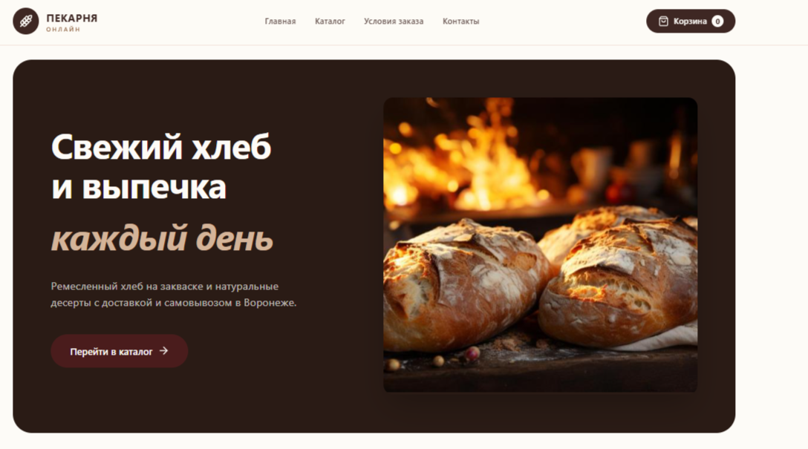
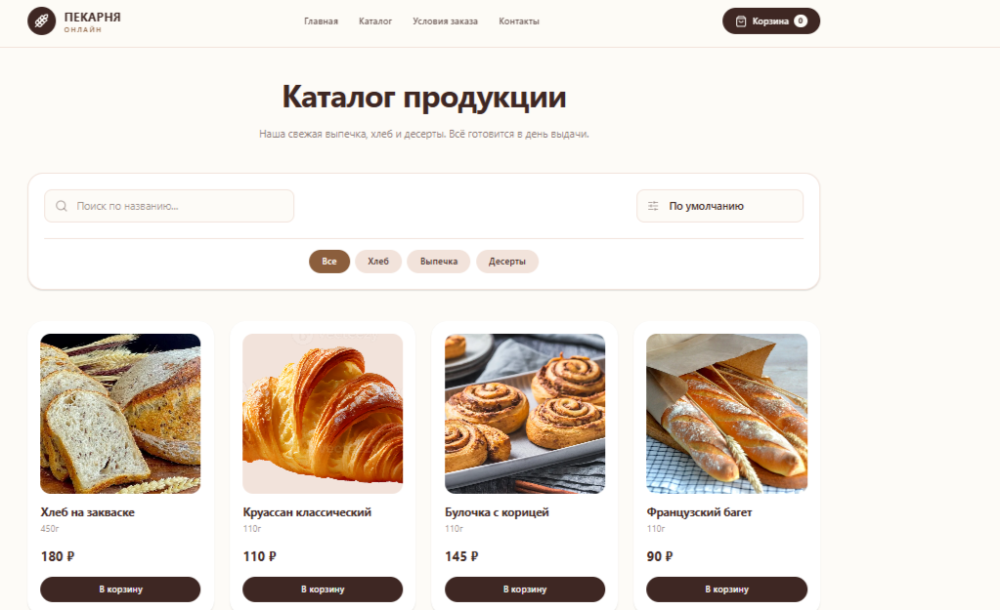
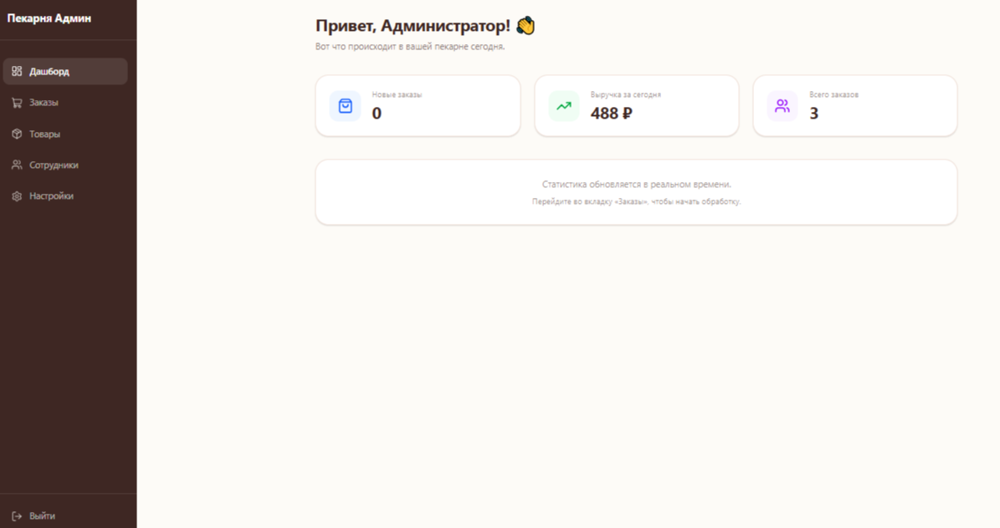
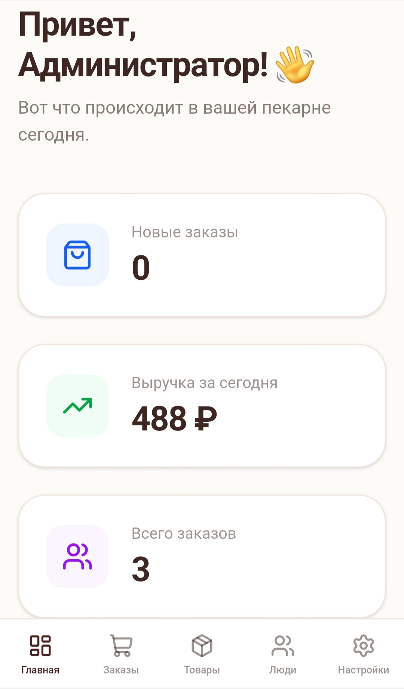

## 📸 Скриншоты

### Главная страница


### Каталог продукции


### Дашборд администратора


### Мобильная версия


# 🥖 Пекарня Онлайн (Bakery Full-Stack)

Премиальное веб-приложение (SaaS) для управления небольшой пекарней. Проект включает в себя публичный сайт-каталог с корзиной и оформлением заказов, а также защищенную административную панель для сотрудников и владельца.

## 🚀 Стек технологий
*   **Frontend:** Next.js 16 (App Router), React 19, TypeScript, Tailwind CSS v4, Framer Motion (анимации), Zustand (корзина и авторизация).
*   **Backend:** Laravel 12, PHP 8.3, Laravel Sanctum (API-авторизация), MySQL.
*   **Архитектура:** REST API, разделение на клиентскую и серверную части (Headless).

## ✨ Основные возможности

### Для клиентов (Публичная часть)
*   Просмотр каталога с фильтрацией по категориям.
*   Поиск по названию и сортировка по цене.
*   Адаптивная корзина (добавление, удаление, очистка).
*   Оформление заказа с выбором времени самовывоза.
*   Серверная проверка цен и валидация времени.
*   Красивые анимации появления элементов (Framer Motion) и плавный скролл (Lenis).
*   **PWA:** Возможность установки сайта на главный экран телефона как нативного приложения.

### Для сотрудников (Админ-панель)
*   Защищенный вход по токенам (Sanctum).
*   **Дашборд:** Статистика продаж за 7 дней с интерактивными графиками (Recharts).
*   **Заказы:** Список заказов с возможностью изменения статусов (Новый, Готовится, Готов и т.д.).
*   **Товары:** Управление каталогом (добавление, редактирование цен, загрузка фотографий).
*   **Сотрудники:** Управление доступами (создание, блокировка).
*   **Настройки:** Редактирование контактной информации магазина (отображается в футере сайта).
*   Полностью адаптивный интерфейс (Mobile-First, Bottom Navigation).

## 🛠 Установка и запуск (Локально)

### 1. Требования
*   PHP 8.2+
*   Composer
*   Node.js (v18+)
*   MySQL

### 2. Запуск Backend (Laravel)
```bash
cd backend
composer install
cp .env.example .env
# Настройте подключение к БД в .env (DB_DATABASE=pekarnya_online)
php artisan key:generate
php artisan migrate:fresh --seed
php artisan storage:link
php artisan serve --host=0.0.0.0 --port=8000
